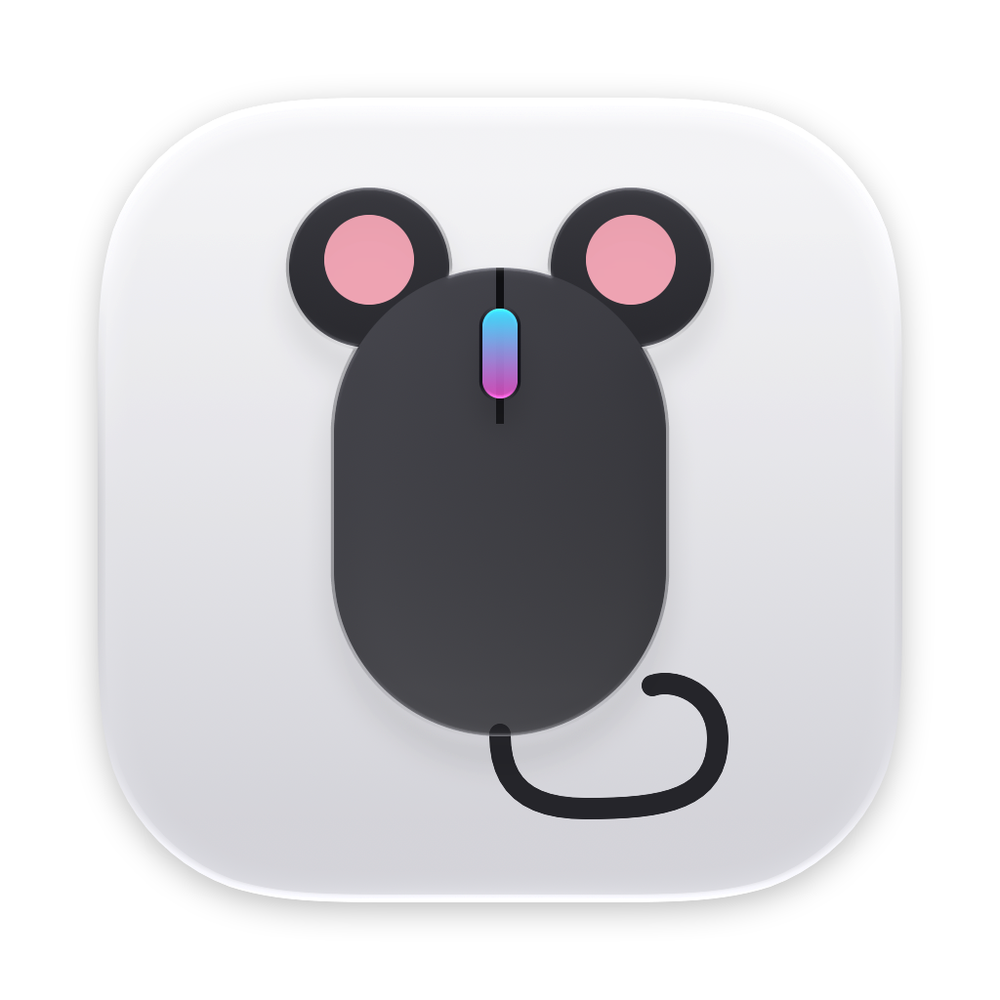
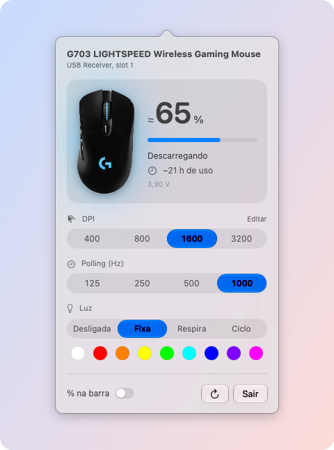
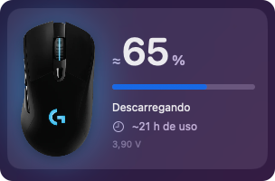
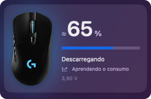
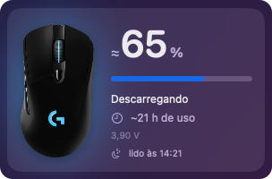

<div align="center">
  
  <h1>🐭 Rato</h1>
  <p>Battery, DPI, polling rate and lighting for Logitech mice, from the <strong>macOS</strong> menu bar.<br>
  Rato talks HID++ to the mouse and saves changes to its onboard profile, so <strong>G HUB doesn't have to be running</strong> or even installed.</p>

  [](https://github.com/eduardoborges/rato/releases/latest)
  [](#requirements)
  [](app/Sources/Rato/)
  [](LICENSE)

  <br>

  <picture>
    <source media="(prefers-color-scheme: dark)" srcset=".github/panel-dark.png">
    
  </picture>

  <p><sub>Rato is what Portugal calls a computer mouse.</sub></p>
</div>

**[Install](#install)** · **[Command line](#command-line)** · **[How it works](RELATORIO.md)**

## Why

G HUB is big, keeps an agent and an updater daemon running all the time, and on my Mac it got stuck on the loading screen. What it does for a G703 (battery, DPI, polling rate, lighting) comes down to a few HID++ calls, so Rato makes just those, from the menu bar.

## What it does

- 🔋 **Battery with time left.** Percentage and hours of use left from a discharge curve Rato learns from your mouse, so G HUB doesn't need to be installed.
- 🎯 **DPI levels.** Edit the levels and pick the default one. The change applies right away.
- ⚡ **Polling rate.** 1, 2, 4 or 8 ms.
- 💡 **Lighting.** Off, fixed color, breathing or color cycle.
- 💾 **Saved on the mouse.** Changes go to the active onboard profile, the same place G HUB writes, so they keep working with Rato closed and after sleep. Every write backs up the profile sectors first and writes the original back if it fails halfway.

Everything is in a panel that opens from a mouse icon in the menu bar. The icon fills up with the battery level and can show the percentage next to it. On macOS 26 and later the selected options use Liquid Glass. Older versions get a flat fill instead. The first time the panel opens, Rato downloads the G703's photo from Logitech's site and keeps it in `~/Library/Application Support/Rato`. Other mice get a drawing.

And the rest:

- A command line with the same settings, plus profile dumps, backup and restore.
- A driver layer for other brands. A generic driver already shows the Bluetooth battery of any mouse.
- It refuses to write while G HUB's agent runs, since both would talk over the same HID++ channel.
- The interface is in Portuguese for now.

## Requirements

- macOS 13 or later
- A Logitech mouse with HID++ 2.0 and onboard profiles (feature `0x8100`). Only tested on a G703 LIGHTSPEED on its USB receiver.
- G HUB closed while Rato writes. It can stay installed.
- Input Monitoring permission for Rato.app. macOS asks on first launch.

## Install

Install it with Homebrew:

```sh
brew install --cask eduardoborges/tap/rato
```

Or grab `Rato.dmg` from the [latest release](https://github.com/eduardoborges/rato/releases/latest). The release is built for Apple silicon only. On an Intel Mac, build it from source as shown below.

## 🛠 Build

You need Xcode 26 or later, because `actool` compiles the Icon Composer icon.

```sh
git clone https://github.com/eduardoborges/rato
cd rato
app/build.sh             # app/build/Rato.app
open app/build/Rato.app
```

`build.sh` signs ad hoc. With `SIGN_IDENTITY` set it signs for distribution with the hardened runtime, and `NOTARY_KEY_ID`, `NOTARY_ISSUER_ID` and `NOTARY_KEY_P8` add notarization. `--dmg` also builds `app/build/Rato.dmg`.

While developing, `swift run` in `app/` starts the menu bar app from the terminal, which lends it the terminal's Input Monitoring permission.

`swift run Rato preview` opens the panel with sample data and never touches the mouse, so it can run next to the app. `preview vazio`, `preview aprendendo` and `preview dormindo` show the other states. The screenshots in this README were taken with it.

## Command line

The same binary takes commands:

```sh
cd app
swift run Rato state                         # DPI, polling rate, mode and lighting effects
swift run Rato profiles                      # the 5 profiles stored on the mouse
swift run Rato set dpi 400,800,1600,3200 4   # DPI levels and which one is the default
swift run Rato set dpi-default 2
swift run Rato set rate 1                    # polling in ms: 1, 2, 4 or 8
swift run Rato set led off                   # or: color ff0000, breathe 00ff00, cycle
swift run Rato backup
swift run Rato restore <backup folder>
swift run Rato selftest                      # driver routing, Bluetooth battery parser, battery model
```

Backups go to `~/Library/Application Support/Rato/backups/`.

## Battery time left

<table>
  <tr>
    <td align="center" valign="top"><br><sub>Curve learned: percentage and hours left</sub></td>
    <td align="center" valign="top"><br><sub>Still learning: no hours yet</sub></td>
    <td align="center" valign="top"><br><sub>Mouse asleep: last reading and when it was taken</sub></td>
  </tr>
</table>

The G703 only reports its battery voltage. G HUB turns that into a percentage and hours with a `battery.xml` it downloads for each mouse: a discharge curve Logitech measured at a constant load (minutes, voltage and energy used), and the draw in mW of the sensor, the MCU, each polling rate and each lighting effect. It finds the energy left at the current voltage and divides it by the draw of the active profile.

Rato doesn't read that file and learns the curve from your mouse instead. Every read while the mouse is awake adds the time since the previous read to the current 20 mV voltage band, and a band counts once the voltage has passed all the way through it. Hours left is the sum of the learned time in the bands below the current voltage. Bands it hasn't learned yet follow a generic Li-ion curve at the pace of the learned ones. What it learns lives in `~/Library/Application Support/Rato/bateria-<pid>.json`.

Until three bands are learned, the percentage comes from the generic curve, which is off by up to about 8 points on the G703, and the panel shows no hours. The estimate gets closer as the mouse goes through a full discharge. The hours count only time with the mouse awake, at the lighting and polling you usually use. Change the lighting and they drift until Rato relearns.

## Common problems

| Symptom | What to do |
|---|---|
| Grayed out icon | Move the mouse to wake it and click ↻ in the panel. If that doesn't help, quit G HUB. `probe` shows what the receiver answered |
| The panel says "Não gravou" | Move the mouse to wake it and try again. If a write fails halfway, Rato writes the original back; `restore` brings back any backup |
| `probe` finds no device | The receiver isn't plugged in, or another process holds the HID channel |
| Nothing shows up in Rato.app | Turn on Rato in System Settings > Privacy & Security > Input Monitoring and reopen it |

## Limitations

- Buttons can't be remapped yet.
- Lighting uses the same effect on both G703 zones.
- The panel has a fixed color palette, and breathing and cycle run at 4 s and 8 s at full intensity. Other colors only from the command line.
- Hours left show up after a few hours of use and only get accurate after a full discharge.
- One mouse per receiver: the first slot that answers.
- Rato doesn't start at login.

## Other mice

Each brand has a driver in `app/Sources/Rato/Drivers/`. There are two today:

| Driver | Mice | What it does |
|---|---|---|
| Logitech | HID++ 2.0, direct or on a receiver | battery, DPI, polling rate, lighting and profile backup |
| Generic | any external mouse without its own driver | name and, over Bluetooth, battery |

The generic driver hasn't been tested with a real mouse, because the only one here was the G703. Its battery parser was checked against two Bluetooth keyboards (`Rato selftest`).

To add a brand:

1. Create `Drivers/<Brand>/` with a class that implements `MouseDriver` and `MouseDriverType`, with the brand's vendor IDs in `vendorIDs`.
2. In `probe`, recognize the right HID interface and return one driver per mouse. Return nothing for the other interfaces.
3. Add the class to `Drivers.all`, before `GenericDriver`.

The panel and the command line show DPI, polling and lighting according to what `readSettings()` returns.

## Reverse engineering

[RELATORIO.md](RELATORIO.md) has the protocol notes, in Portuguese: HID++ framing on macOS, feature discovery, battery, the lighting recipe, the onboard profile layout and the battery model.

The repo also sets up [REA](https://github.com/morluto/rea) for Claude Code without touching the global config. mise installs Node, Java 21, Ghidra 12.1.4 and REA itself:

```sh
mise install
mise exec -- rea doctor --provider ghidra --json
```

Then open Claude Code at the repo root. `.mcp.json` registers the server and the skill lives in `.claude/skills/`. Ghidra's zip ships no decompiler for arm64 Macs, so the first `mise install` builds one (it needs the Xcode Command Line Tools).

The analyzed binary stays out of git. It's 105 MB and belongs to Logitech, so it can't be redistributed. To recreate it with G HUB installed:

```sh
mkdir -p analysis
lipo -thin arm64 \
  /Applications/lghub.app/Contents/MacOS/lghub_agent.app/Contents/MacOS/lghub_agent \
  -output analysis/lghub_agent.arm64
shasum -a 256 analysis/lghub_agent.arm64
# 830c86d14865bfd263e11582af756c919985e10fb87542d3acf9e11f4d2151f8 (the analyzed version)
```

## Repository layout

- `app/`: the Swift package. `Core/` has the shared model and the HID engine, `Drivers/` one driver per brand
- `app/AppIcon.icon`: the Icon Composer icon
- `app/build.sh`: builds and signs `Rato.app`
- `RELATORIO.md`: the protocol, step by step
- `mise.toml` and `scripts/`: the analysis tools
- `.mcp.json` and `.claude/`: REA for Claude Code
- `analysis/lghub_agent.arm64`: the arm64 slice of `lghub_agent`, where the protocol came from (not in git)

## License

MIT, see [LICENSE](LICENSE). Logitech, G HUB and LIGHTSPEED are trademarks of Logitech. Rato isn't affiliated with Logitech. The G703 photo in the screenshots is Logitech's and comes from its website.
